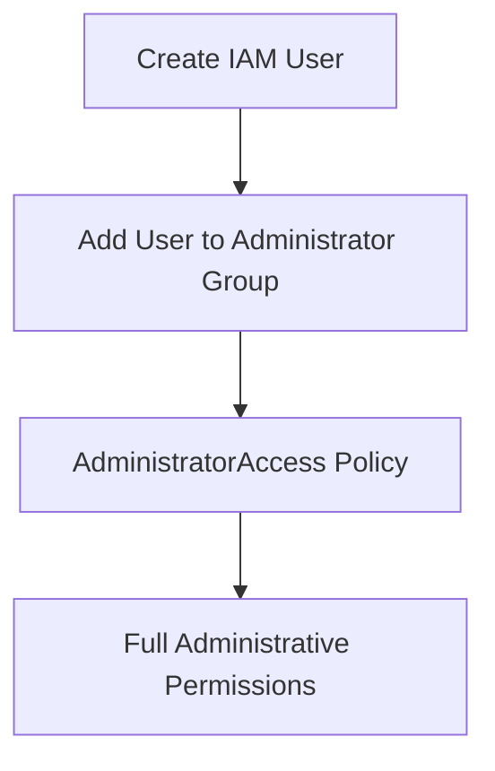

# AWS Server Monitoring and IAM Access Management

## Project Overview

This project demonstrates the implementation of a server monitoring and access management solution using **Amazon Web Services (AWS)**.

A client deployed a Windows Server 2012 EC2 instance to support its internal operations. Following deployment, a monitoring and alerting framework was required to maintain performance visibility, identify unusual server behaviour and support proactive issue detection.

The project focused on monitoring EC2 CPU utilisation using **Amazon CloudWatch**, configuring automated email alerts through **Amazon SNS**, and establishing administrative access controls using **AWS Identity and Access Management (IAM)**.

## Objectives

The key objectives of this project were to:

- Monitor and analyse CPU utilisation metrics for an EC2 instance.
- Configure a CloudWatch alarm to detect CPU utilisation below 3%.
- Set up email notifications through Amazon SNS for the monitoring team.
- Create an IAM group named `Administrator Group`.
- Attach the AWS-managed `AdministratorAccess` policy to the IAM group.
- Create a new IAM user and assign administrative access through group membership.
- Apply security practices such as MFA and secure password policies.

## AWS Services Used

| AWS Service | Purpose |
|---|---|
| Amazon EC2 | Hosts the Windows Server 2012 instance. |
| Amazon CloudWatch | Monitors EC2 CPU utilisation metrics and generates alarms. |
| Amazon SNS | Sends email notifications when the alarm condition is met. |
| AWS IAM | Manages users, groups and administrative permissions. |
| AWS Management Console | Provides the interface for configuring and managing AWS resources. |

## Architecture Overview

The solution uses Amazon CloudWatch to monitor the EC2 instance and Amazon SNS to notify the support team when the configured CPU utilisation threshold is breached.

IAM provides a separate access management structure for employees who require administrative permissions.

### Monitoring and Alerting Workflow

```mermaid
flowchart TD
    A[Windows Server 2012 EC2 Instance] --> B[Amazon CloudWatch]
    B --> C[Monitor CPUUtilization]
    C --> D{CPU Utilization Below 3%?}
    D -->|Yes - Alarm condition met| E[CloudWatch Alarm]
    D -->|No| C
    E --> F[Amazon SNS]
    F --> G[Email Notification]
    G --> H[HCMonitor@HeavenClassics.com]
```

### IAM Access Management Workflow



## Implementation Details

### 1. EC2 CPU Utilisation Monitoring

Amazon CloudWatch was used to monitor the performance of the Windows Server 2012 EC2 instance.

**Implementation steps:**

1. Accessed the AWS Management Console.
2. Navigated to the EC2 service and selected the deployed instance.
3. Opened the **Monitoring** tab to view CPU utilisation metrics.
4. Reviewed the CPU utilisation graphs to analyse server performance.
5. Used the available metrics to identify performance trends and potential bottlenecks.

**Key metric monitored:**

- `CPUUtilization` – Measures the percentage of allocated EC2 compute capacity currently being used.

This provided visibility into the instance's CPU performance and supported ongoing monitoring and troubleshooting.

### 2. CloudWatch Alarm Configuration

A CloudWatch alarm was configured to monitor CPU utilisation and trigger an email notification through Amazon SNS when the defined threshold was breached.

**Alarm configuration:**

| Configuration | Value |
|---|---|
| Alarm Name | EC2 CPU Utilisation Alarm |
| Metric | `CPUUtilization` |
| Threshold | Less than 3% |
| Period Duration | 5 minutes |
| Evaluation Periods | 3 |
| Notification Service | Amazon SNS |
| Notification Email | `HCMonitor@HeavenClassics.com` |

**Implementation steps:**

1. Opened Amazon CloudWatch in the AWS Management Console.
2. Navigated to **Alarms** and selected the option to create an alarm.
3. Selected the EC2 `CPUUtilization` metric for the target instance.
4. Configured the threshold condition to trigger when CPU utilisation fell below 3%.
5. Set the evaluation period to three periods, each lasting five minutes.
6. Configured an Amazon SNS notification action.
7. Specified `HCMonitor@HeavenClassics.com` as the notification recipient.
8. Created the alarm and configured the notification subscription.

**Expected result:**

When the configured alarm condition is met, CloudWatch changes the alarm state and Amazon SNS sends an email notification to the designated monitoring address.

### 3. IAM Group Creation – Administrator Group

An IAM group was created to provide centralised management of administrative permissions.

**Implementation steps:**

1. Opened the AWS IAM service.
2. Navigated to **User groups** and selected Create group.
3. Created a group named `Administrator Group`.
4. Selected the AWS-managed `AdministratorAccess` policy.
5. Attached the policy to the newly created group.

**Permission configuration:**

| Setting | Configuration |
|---|---|
| IAM Group | `Administrator Group` |
| Attached Policy | `AdministratorAccess` |
| Permission Level | Full administrative access |

The group provides a centralised way to manage administrative permissions for users who require elevated access.

### 4. IAM User Provisioning

A new IAM user was created for an employee who required administrative access to the AWS environment.

**Implementation steps:**

1. Navigated to the IAM Users section.
2. Created a new employee user.
3. Configured programmatic and AWS Management Console access.
4. Added the user to the `Administrator Group`.
5. Applied the relevant account security settings.

**Security considerations:**

- Used the IAM group to assign permissions rather than attaching the administrator policy individually to the user.
- Applied secure password policies.
- Enforced or configured Multi-Factor Authentication (MFA) as part of the access security approach.

By adding the user to the group, the employee inherited the permissions associated with the `AdministratorAccess` policy.

## Validation and Expected Results

The following checks were used to assess the configured solution:

| Area | Validation |
|---|---|
| EC2 Monitoring | Confirmed that CPU utilisation metrics were visible in CloudWatch. |
| CloudWatch Alarm | Checked the alarm configuration against the required metric and threshold. |
| SNS Notifications | Verified the configured notification recipient and SNS subscription. |
| IAM Group | Confirmed that `Administrator Group` existed and had the `AdministratorAccess` policy attached. |
| IAM User | Confirmed that the new user was a member of the administrator group. |
| Access Security | Reviewed the configured password and MFA security settings. |

## Project Outcomes

The project established a monitoring and access management framework for client's AWS EC2 environment.

Key outcomes included:

- **Improved performance visibility:** CloudWatch provided access to EC2 CPU utilisation metrics.
- **Proactive monitoring:** Automated alarms were configured to identify CPU utilisation below the defined threshold.
- **Email-based alerting:** Amazon SNS provided a notification mechanism for the monitoring team.
- **Centralised access management:** IAM groups simplified the assignment of administrative permissions.
- **Improved access security:** IAM user provisioning and security controls supported structured administrative access.

## Technical Skills Demonstrated

- AWS Management Console
- Amazon EC2
- Amazon CloudWatch
- CloudWatch Metrics and Alarms
- Amazon SNS
- AWS IAM Users and Groups
- AWS Managed Policies
- AdministratorAccess Policy
- Monitoring and Alerting
- Cloud Infrastructure Support
- Identity and Access Management
- Troubleshooting and Operational Monitoring

## Key Learnings

Through this project, I gained practical experience in:

1. Monitoring EC2 instance performance using Amazon CloudWatch.
2. Configuring metric-based alarms for proactive issue detection.
3. Integrating CloudWatch alarms with Amazon SNS for email notifications.
4. Managing IAM users, groups and AWS-managed policies.
5. Applying centralised permission management and security best practices.

## Conclusion

This project demonstrated how AWS monitoring and identity management services can be used together to support reliable cloud operations.

By implementing CloudWatch monitoring, SNS notifications and IAM-based administrative access, the solution provided to the client with improved performance visibility, automated alerting and structured access management.

These skills form an important foundation for cloud infrastructure monitoring, operational support and AWS administration.
